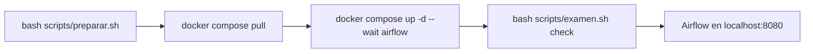
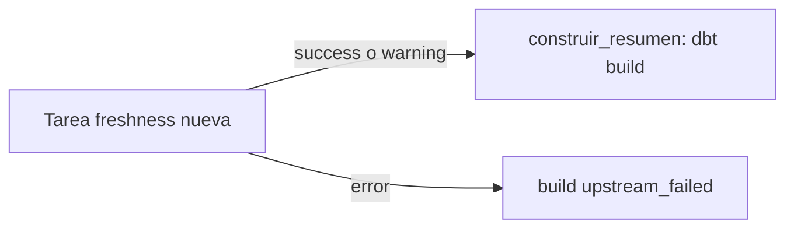

# Examen final: ventas diarias con control de actualidad

Una empresa de comercio electrónico consulta un resumen diario de ventas para decidir promociones e inventario. A veces la carga se retrasa y el proceso puede terminar sin errores técnicos, aunque reconstruya el resumen con información desactualizada. Tu trabajo es completar la tabla analítica y evitar su reconstrucción cuando la fuente sea demasiado antigua. **No se requiere un dashboard.**

No modifiques datos, pruebas, perfiles, la función auxiliar ni la infraestructura. Solo debes modificar estos tres archivos:

- `dbt/models/ventas_diarias.sql`
- `dbt/models/sources.yml`
- `airflow/dags/examen_ventas.py`

## Preparar el entorno

Antes de empezar, abre Docker Desktop y espera a que esté encendido. En Windows usa la terminal de Ubuntu en WSL2. En Mac usa la Terminal.

Ejecuta estos comandos desde la carpeta de este proyecto:



```bash
bash scripts/preparar.sh
docker compose pull
docker compose up -d --wait airflow
bash scripts/examen.sh check
```

Abre http://localhost:8080 e inicia sesión con:

- Usuario: `estudiante`
- Contraseña: `examen-local`

Activa el DAG `examen_ventas`. Si `check` falla, avisa al docente antes de continuar.

### Si ya preparaste el entorno con el ZIP

Si ya tienes el entorno funcionando desde el ZIP de preparación compartido previamente, no lo reconstruyas. Desde la carpeta de este proyecto:

1. Conserva el archivo `.env` que creó `bash scripts/preparar.sh`. No lo borres ni lo reemplaces.
2. Ejecuta `docker compose up -d --wait airflow`.
3. Ejecuta `bash scripts/examen.sh check`. 

No ejecutes `docker compose down -v`: borra el resumen y las evidencias que ya tengas.

## Datos y resultado requerido

`raw.ventas` contiene una fila por venta de un único producto:

| Columna | Significado / tipo |
|---|---|
| `id_venta` | Identificador único, INTEGER |
| `fecha_venta` | Fecha del negocio, DATE |
| `cantidad` | Unidades vendidas, INTEGER |
| `precio_unitario` | Precio por unidad, DECIMAL(12,2) |
| `_loaded_at` | Instante de carga en raw, TIMESTAMPTZ en UTC |

Los seis registros están en `data/ventas.csv`. El script de preparación agrega marcas de carga relativas al momento de ejecución. Todos los escenarios conservan los mismos datos de negocio. El arranque y las tareas no recargan raw.

El modelo `analytics.ventas_diarias` debe ser una tabla con **una fila por `fecha_venta`**:

- `fecha_venta`: fecha del negocio.
- `numero_ventas`: conteo de ventas.
- `unidades_vendidas`: suma de cantidad.
- `ingreso_total`: suma de cantidad por precio unitario, conservando precisión decimal.

Resultados esperados:

| fecha_venta | numero_ventas | unidades_vendidas | ingreso_total |
|---|---:|---:|---:|
| 2026-01-10 | 2 | 3 | 46.00 |
| 2026-01-11 | 3 | 6 | 51.25 |
| 2026-01-12 | 1 | 4 | 12.40 |

Las pruebas incluidas verifican unicidad, campos obligatorios, valores básicos válidos y coincidencia con estos resultados. Una tabla vacía no supera las pruebas del resumen.

## Concepto: source freshness

Source freshness comprueba la **actualidad de fuentes declaradas en dbt**. `dbt source freshness` ejecuta esa comprobación: no carga ni transforma ventas. Aquí consulta el máximo de `_loaded_at` y lo compara con la hora actual, en UTC. Permite definir umbrales de advertencia y error.

Declarar la configuración no ejecuta la comprobación. **`dbt build` tampoco la incluye automáticamente.** Unas pruebas exitosas de unicidad y campos obligatorios pueden coexistir con datos desactualizados. Por eso comprobarás freshness antes de construir el resumen.

`fecha_venta` indica cuándo ocurrió una venta. `_loaded_at` indica cuándo llegó al sistema. Una venta antigua puede cargarse hoy. Este control comprueba la carga más reciente, pero por sí solo no demuestra que hayan llegado todas las ventas esperadas.

Ficha de sintaxis para dbt Core 1.9. El ejemplo usa otro dominio y otros umbrales para que te orientes al configurar la fuente del ejercicio:

```yaml
version: 2
sources:
  - name: biblioteca_raw
    schema: raw
    tables:
      - name: prestamos
        loaded_at_field: recibido_en
        freshness:
          warn_after: {count: 3, period: hour}
          error_after: {count: 6, period: hour}
```

En la versión instalada, declara `freshness` y `loaded_at_field` como propiedades de la tabla, al mismo nivel y fuera de `config`. Una advertencia de freshness permite continuar con salida exitosa. Un error produce salida fallida. No actives `--warn-error` ni opciones equivalentes.

Referencias oficiales: [configuración freshness](https://docs.getdbt.com/reference/resource-configs/freshness), [comando source](https://docs.getdbt.com/reference/commands/source), [loaded_at_field](https://docs.getdbt.com/reference/resource-properties/loaded_at_field). Las páginas actuales también describen versiones posteriores. Usa la sintaxis 1.9 de esta ficha.

## Actividades

Este es el flujo que debes lograr en el DAG:



1. **Modelo:** completa `dbt/models/ventas_diarias.sql` usando `ref('stg_ventas')`. La materialización como tabla ya está configurada. Ejecuta el build y comprueba las pruebas.
2. **Freshness:** completa `dbt/models/sources.yml` usando `_loaded_at`. Hasta 12 horas corresponde al estado normal. Más de 12 y hasta 24 horas debe producir una advertencia. Más de 24 horas debe producir un error.
3. **Airflow:** completa `airflow/dags/examen_ventas.py`. Agrega una tarea que ejecute `dbt source freshness`, reutilizando `run_dbt`, y establece la dependencia antes de `construir_resumen`. La función recibe una lista de argumentos dbt y propaga errores. El operador existente muestra cómo invocarla. La advertencia debe permitir build y el error debe bloquearlo. Mantén la regla de ejecución predeterminada `all_success` y deja que los errores se propaguen a Airflow.
4. **Demostración y respuestas:** ejecuta los dos escenarios obligatorios y responde las preguntas conceptuales.

## Comprobación

Después de completar el modelo:

```bash
bash scripts/examen.sh dbt build
bash scripts/examen.sh query 'select * from analytics.ventas_diarias order by fecha_venta'
```

Todas las pruebas deben pasar. Los comandos directos te ayudan a comprobar SQL. Las evidencias de orquestación se obtienen desde el DAG.

### 1. Fuente actualizada (obligatorio)

```bash
bash scripts/examen.sh scenario actualizada
```

Cuando el gráfico de Airflow muestre la nueva tarea que agregaste, pulsa **Trigger DAG** y espera a que termine la ejecución. Freshness y build deben estar en `success`, con freshness antes de build. Revisa el log de ambas tareas. La función auxiliar imprime `INICIO dbt` y `FIN dbt`. Guarda una captura con el identificador de ejecución y los estados.

Consulta y guarda el resumen:

```bash
bash scripts/examen.sh query 'select * from analytics.ventas_diarias order by fecha_venta'
```

### 2. Fuente desactualizada (obligatorio)

Conserva la tabla anterior y espera a que no haya tareas en ejecución:

```bash
bash scripts/examen.sh scenario desactualizada
```

Pulsa **Trigger DAG** para crear una **nueva ejecución**. No reutilices ni limpies tareas de la anterior. Freshness debe quedar `failed` por superar 24 horas y build debe quedar `upstream_failed`, sin ejecutarse. Guarda una captura de los estados y del identificador de ejecución, junto con el log de freshness que muestra el motivo del error. Verifica que build no tenga un nuevo intento ejecutado ni una marca `INICIO dbt` para esta ejecución.

Repite la consulta del resumen y comprueba que conserva las mismas filas. **Bloquear significa conservar el resumen anterior, no borrarlo.** La igualdad de contenido no demuestra por sí sola que build no corrió, ya que los datos de negocio no cambian. Incluye también los estados de Airflow como evidencia.

### Opcional: advertencia

```bash
bash scripts/examen.sh scenario advertencia
```

Lanza otra ejecución manual. El log debe informar una advertencia por las 18 horas transcurridas. Freshness y build deben terminar en `success`. No se exige una tercera evidencia.

| Escenario | Última carga aproximada | Freshness | Construcción |
|---|---|---|---|
| actualizada | hace 2 h | pasa | se ejecuta |
| advertencia | hace 18 h | advierte | se ejecuta |
| desactualizada | hace 30 h | falla | bloqueada |

Prepara cada escenario justo antes de probarlo. Los comandos son repetibles y solo sustituyen raw con los mismos datos de negocio y nuevas marcas de carga.

Para inspeccionar la carga y los últimos artefactos dbt:

```bash
bash scripts/examen.sh query 'select count(*), max(_loaded_at) from raw.ventas'
bash scripts/examen.sh artifacts
```

Los artefactos corresponden al último comando dbt y pueden sobrescribirse. Los estados de cada ejecución quedan en Airflow. No ejecutes manualmente build entre la preparación del escenario desactualizado y la captura de sus evidencias.

## Preguntas conceptuales

1. ¿Por qué usar `_loaded_at` y no `fecha_venta` para este control?
2. ¿Por qué las pruebas de integridad no garantizan actualidad?

## Entregables

Entrega los tres archivos modificados, las capturas de las dos ejecuciones obligatorias y el log que explica el fallo de freshness. Incluye también el resumen consultado antes y después del bloqueo y un documento breve con las dos respuestas. No incluyas imágenes Docker, volúmenes ni credenciales personales.

## Detener y retomar

```bash
docker compose stop
docker compose up -d --wait airflow
```

El paso del tiempo sigue afectando freshness tras reiniciar. Prepara de nuevo el escenario que vayas a evaluar. No ejecutes `docker compose down -v`: elimina los volúmenes con el resumen y las evidencias. No hace falta reconstruir la imagen tras editar los tres archivos. Airflow actualiza el DAG automáticamente.
